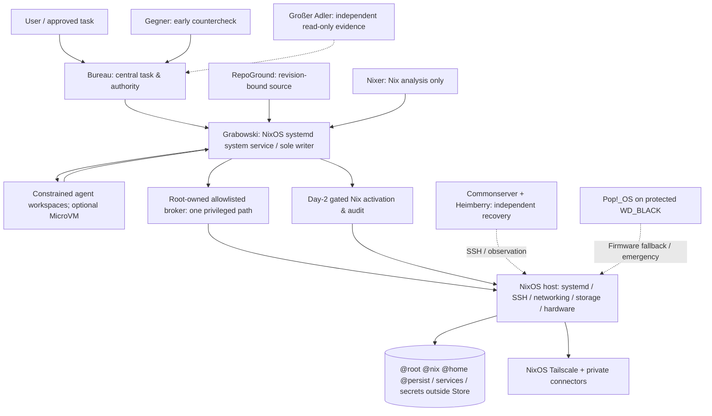

# ADR-2026-10-23: NixOS is the permanent primary Heim-PC system

**Decision:** Accepted on 2026-10-23 (Europe/Berlin). **Implementation:** In progress; this ADR does not constitute production acceptance, a deployment approval, or authorization to modify disks or firmware.

**Scope:** `heimgewebe/heim-pc`, NixOS on the existing Seagate NVMe, existing Pop!_OS on the protected WD_BLACK NVMe. Supersedes the earlier architecture assumption that NixOS is merely an optional secondary OS. The two OS installations remain independently bootable.

## Non-negotiable outcome and authority

- **Seagate / NixOS:** Normal UEFI boot target and permanent productive host for interactive workstation, development, local AI, automation, Grabowski, and required heimgewebe services.
- **WD_BLACK / Pop!_OS:** Retained, independently bootable emergency and recovery system. No repartition, formatting, migration overwrite, or changes to its ESP as part of this work.
- **Grabowski:** Sole primary writer for explicitly authorized source, runtime, deployment, and privileged operations. It runs as a **system-level systemd service on NixOS**, independent of local login/SDDM; it has no ambient root privileges. The existing **root-owned, allowlisted privileged broker** remains the only privileged action path; do not create a second broker or general agent sudo.
- **Bureau:** Central task/work-lane/authority state; does not become root operator. **RepoGround:** revision-bound regenerable repository context. **Nixer:** Nix specialist, no generic mutation. **Großer Adler:** independent read-only verification. **Gegner:** early counterchecks, not a reviewer or an authority source.
- **Commonserver and Heimberry:** Independent SSH/observation/recovery path outside the Heim-PC; not competing primary writers. Direct NixOS Tailscale enrollment gets its own identity; never clone Pop!_OS identity.
- **Controlled agents:** Trusted dispatch/verification on host; untrusted coding work in isolated workspaces with explicit filesystem/network/cgroup limits and MicroVM only where stronger isolation is justified. Reviewed results go to Grabowski, never directly to root.
- **Reproducibility:** Git-pinned Nix evaluation, build, independent review when required, Day-2 activation gate, runtime readback and protected last-known-good generation. Workload state is migrated independently from the Nix store.

This is a **target-state decision**, not a claim that the target already runs.

## Fresh evidence versus open gates

Evidence documented in [hardware issue #237](https://github.com/heimgewebe/heim-pc/issues/237#issuecomment-6358847583), 2026-10-23:

- Physical NixOS 26.05 Seagate Btrfs boot with successful public-key SSH login from the independent Commonserver/Heimberry route; then successful Pop!_OS return to WD_BLACK.
- Stage0 mounts: `@root`, `@nix`, `@home`, `@persist`, with separate Seagate EFI and recovery partitions. Stage0 root is **unencrypted**.
- The 18-minute **root/system** one-shot return timer worked; the additional user timer failed due to incorrect sudo execution and was disabled. Neither one-shot marker remains armed.
- After return, Pop!_OS remained default; `BootOrder=0000,0001,0002`, no `BootNext`. A Seagate firmware entry exists but is not in the permanent order. Verify its **actual device and EFI path** again before changing anything.
- Pop!_OS is still the currently operating system. Neither production NixOS Grabowski/rootbroker, NixOS Tailscale, KDE/NVIDIA/GUI/audio nor critical application parity is established by the first boot.

The previous `nixos/production/contract-v1.json` designates `nixos-primary` with `popos-fallback`, but its LUKS2/TPM2-encrypted storage profile is **not** the physical Stage0 layout. Do not silently apply `storage-layout.nix` to that Stage0 filesystem, weaken its production contract, or format the disk to make the old contract appear satisfied. A future encryption migration requires its own explicit non-destructive plan, tested restore and required authorization.

## Trust, authority and failure boundaries

The host can fail independently of the external recovery hops; conversely a successful SSH login does not prove the operator and data are healthy. Compromise of an untrusted workspace must not grant host filesystem, sockets, rootbroker request authority, raw GPU, SSH credentials, or secrets without an explicit capability. Do not make Bureau's authority dependent on duplicated local queues or uncontrolled user timers.

## Service placement and migration classification

| Component | Intended runtime | Persistent state | Class and acceptance gate |
| --- | --- | --- | --- |
| SSH, NetworkManager, firewall, systemd | NixOS system units | host keys / network state under restricted persistent paths | **Day-1**; independent key-only login after reboot |
| Tailscale | NixOS system unit | fresh NixOS device state, never reused Pop ID | **Day-1**; enroll and verify remote reachability |
| Rootbroker | root-owned socket plus per-request scoped system unit | root-owned policy/audit; outside Nix Store | **Day-1**; verify ownership, ACL, allowlist and denied action |
| Full Grabowski operator, ingress and required tunnel | NixOS system units as restricted service identity | release IDs, work lanes, leases, audit, credentials separately | **Day-1**; actual MCP/tool roundtrip without desktop login; no demo replacement |
| Bureau authoritative control plane | system service/timers as justified by live inventory | transactional task state and backups | **Day-1**; real claim/closeout and restore verification |
| RepoGround | system service or on-demand index job | source repos distinct from regenerable index | **Day-1** for required operator context; pinned context query |
| Nixer, Adler, Gegner | narrow adapters; system services if headless availability required | minimal state / review findings | **Day-1** if used by operator gates; verify per-role permission |
| Git, coding tools, workspaces | declarative packages + transient constrained units | repositories/worktrees separated from caches | **Day-1** for active work only |
| Backup/Restic + restore evidence | system timers and audited jobs | backups on independently verifiable destination | **Day-1** for critical state; tested restore before source retirement |
| KDE Plasma 6, SDDM, NVIDIA, PipeWire | graphical host and session services | personal display/audio settings | **Day-1 before desktop role assumption**, independent of headless access |
| Ollama / GPU local inference | system service on demand or when measured load requires it | model library, regenerable downloads separately | Post-migration unless essential for Day-1 agent workflow |
| Paperless/DB, Stirling-PDF, media/audio bridges | preserve existing data; migrate per live dependence | database exports, document stores and volumes | Post-migration or Day-1 **only after use/dependency evidence** |
| Monitoring/dashboard/Leitstand, Chronik, Flowlines | reuse existing independent services where fit; no duplicate stack | receipts, observability retention | Prioritize minimum viable Day-1 monitoring; remainder post-migration |
| Distributionspecific Pop!_OS services | no direct translation | none | Replaced/retired, verified per inventory |

The observed Pop!_OS enabled-unit totals are **not** a list of services to copy. Reconcile **every current candidate** against the existing `day1-workload-parity-contract-v1.json`. Its `current_binding` and productive-role consumer must not be presented as ready until actual sourced inventory and acceptance are implemented.

## Filesystems, state and secrets

Keep the physical Seagate partitions and Btrfs subvolumes unchanged:

- `/etc/nixos` and pinned flake: declarative configuration in Git; private host bindings kept out of Git/Store.
- `/nix` (`@nix`): immutable store, generations, GC roots; no application secrets; protect last-known-good.
- `/home` (`@home`): interactive user files and explicitly selected `~/repos` and workspaces, with UID/GID/ACL/xattr migration checks.
- `/persist` (`@persist`): service identities, rootbroker authorization/audit, persistent services and secrets only in root-controlled restricted locations. Use systemd `StateDirectory`/`LoadCredential` and private provisioning as appropriate; actual paths are service-contract dependent.
- `/var/lib`: persistent application/DB data, containers/VMs separated by ownership and backup lifecycle; bind to established `@persist` or `@home` policy where needed. Do **not** add `@data`/`@containers` merely for aesthetic parity.
- `/var/cache`, build outputs, RepoGround indexes, model caches: disposable/regenerable unless separately justified; logs have bounded retention.
- Backups: independently recoverable location, no replacement or pruning of old backups before a verified new backup **and restore** path.

Do not copy full Pop!_OS root, old Docker layers, cached repositories or stale agent machine identities. Use pinned checkout reconstruction, consistent database dumps, allowlisted files and authority-specific controlled state reconciliation.

## Security and controlled activation

1. Preserve WD_BLACK; no formatting, GPT edits, ESP writes or destructive operations under this ADR.
2. Retain Seagate Stage0 as an explicitly isolated fallback while introducing a **separate** unactivated primary candidate. Never auto-enable its legacy auto-login or passwordless wheel sudo.
3. Key-only SSH, independent recovery hop, separate Tailscale identity, expected PAM account checks; validate NixOS sudo via its provided setuid wrapper where needed, but keep rootbroker as actual privileged execution path.
4. Run real Grabowski from pinned runtime release as a restricted **system service**, with a root-owned broker socket and recovery/audit resources; protect secrets from environment, Git and Nix derivations.
5. Evaluate, build and test exact Nix candidate commit; independently review privilege, networking, storage and activation changes. Do not conflate all-green CI with physical runtime evidence.
6. Carry forward migration and backup after source-scoped inventories; verify each Day-1 workload and a negative privilege test.
7. Before any controlled new boot, re-read physical disk identities, EFI path, BootCurrent/Order/Next, timers, mounts and active leases; validate a bounded one-shot return or other tested recovery mechanism. Reboot once, verify OS/SSH/operator and independent recovery, **then only** consider NixOS permanent BootOrder.
8. Keep a GC-protected last-known-good generation, an independently tested Pop!_OS recovery selection and Nicole's local fallback procedure. A lost network link or pre-kernel freeze may require physical intervention.

## Acceptance definition and change boundaries

Primary-system migration is accepted **only** after real proofs: default NixOS boot and second observed reboot; no-login SSH/Tailscale; full Grabowski + broker + Bureau/agent role gates; data restore/backup; selected workload parity; desktop/NVIDIA/audio tests; protected Nix generation; actual WD recovery; revision-bound reproducibility and independent security review.

Until then, project status remains **not cut over**. Stage0 first-boot proof cannot be promoted into production readiness. Do not merge a source-only Stage0 PR as implicit production approval. This ADR grants no new authority for storage encryption transitions, Secure Boot key enrollment, TPM2 changes, firmware mutation or destructive cutover.

**Implementation reference:** `nixos/system/flake.nix` profile `heim-pc-seagate-primary-candidate` and `nixos/system/modules/seagate-primary-candidate.nix` are evaluation/build-only first increments, not the finished operator, desktop or encrypted system.
